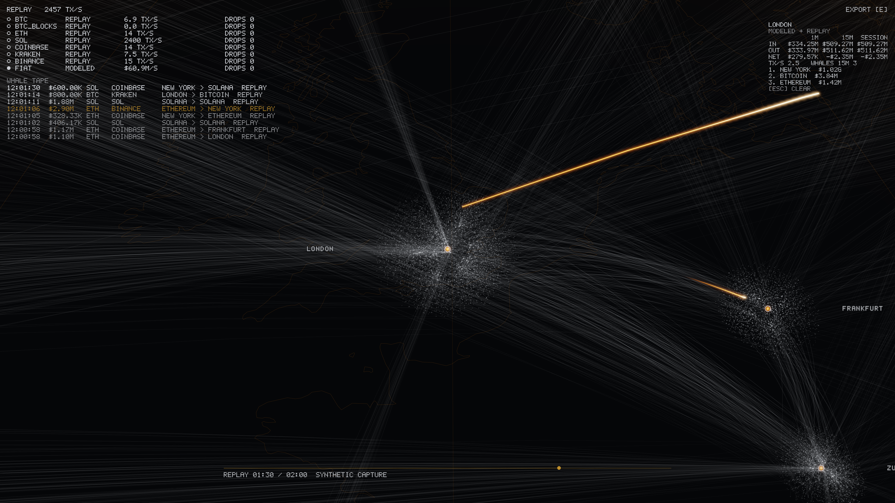
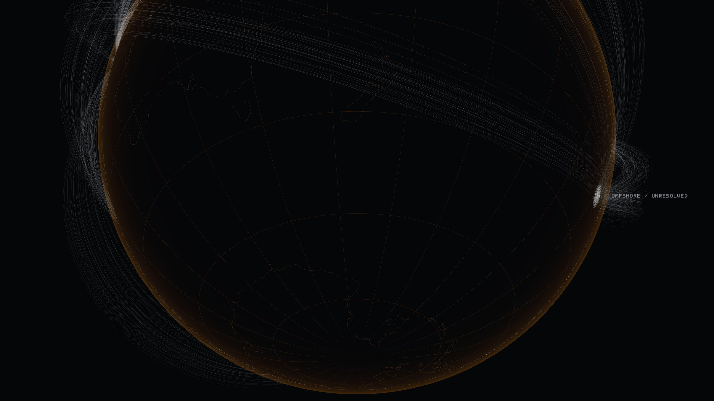
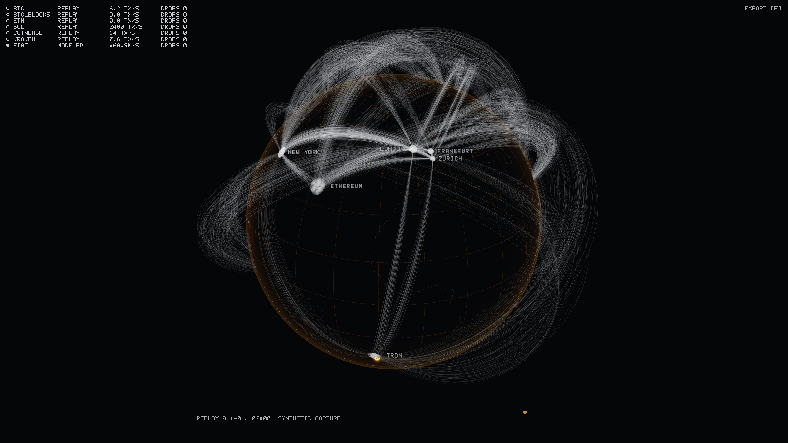

# ftviz

A C++20 / OpenGL 4.5 visualizer for financial flows on a dark globe:
public crypto feeds live, ECB reference rates, modeled fiat corridors,
optional transaction graphs from a file, and the largest transfers burning
from deep amber to white gold. One self-contained executable: shaders,
coastlines, configuration and the replay capture are compiled in.


## Download and run (Windows)

1. Open the repository's **Releases** page (or the latest run of the
   `release` workflow under **Actions**) and download `ftviz.exe`.
2. Double-click it. No installer, no DLLs, no folders next to it.

The globe opens and connects to every public feed. Feeds that connect turn
LIVE in the top-left HUD; if the machine is offline, after 15 s the bundled
capture plays and every row says REPLAY. Windows SmartScreen may warn on
first launch because the exe is unsigned ("More info" → "Run anyway").

Requirements: 64-bit Windows 10 or 11 and a GPU driver with OpenGL 4.5
(any NVIDIA, AMD or Intel driver from the last several years; 4.3 with
`ARB_direct_state_access`, `ARB_buffer_storage` and `ARB_clip_control`
also works). Started from a terminal, `ftviz.exe --help` lists every option
and log output appears in that terminal.

macOS is not supported: Apple's OpenGL stops at 4.1. On Linux, build from
source (below); the binary depends only on libc and libm.

## Features

- **Globe.** Natural Earth coastlines, a 15° graticule, an amber
  atmosphere rim with a Fresnel falloff, hubs that glow and pulse softly.
  Arcs fade with depth and are hidden behind the globe.
- **Plasma trails.** Every live trade or transfer of at least 2,500 USD
  between two hubs is a short amber trail; whales (per feed USD
  thresholds) are brighter HDR ribbons whose head and core heat from Deep
  Amber `#FF9A1F` to White Gold `#FFF1C9`. Obsidian `#050608` background,
  amber `#C8962E` lines, ink `#D9DCE1` for everything else.
- **Live feeds by default.** Bitcoin, Ethereum, Solana, Coinbase, Kraken
  and Binance over public WebSocket endpoints, ECB rates over HTTPS. Each
  feed reconnects with jittered backoff and rotates through fallback URLs
  when DNS, TCP or TLS fails.
- **HUD.** LIVE x/y streams and total TX/s, a row per feed with state,
  rate, latency and drops, the ECB date and EURUSD, a scrolling tape of the
  last eight whales, a hub panel on click, an EXPORT button.
- **Honest labels.** Every source is LIVE, DELAYED, MODELED or REPLAY
  wherever it appears: HUD, hub panel, whale tape, exports.
- **Offline fallback.** Only when no feed is LIVE (the machine is
  offline) does the bundled capture play, labelled REPLAY.
- **Export.** One key or click writes the session to five CSV and JSON files.
- **Interaction.** Hover and pin hubs, five camera presets, pause, scrub.
- **Fixed frame.** 8 scene draws and 8 post draws per frame whatever the
  data; zero heap allocations per frame on the render, model and layout
  threads (asserted in Debug builds).
- **Deterministic screenshots.** `--screenshot` renders offscreen; the
  same command gives the same bytes.

## Gallery

Engine frames at 3840×2160 from the commands under
[Screenshots](#screenshots). They replay the bundled capture, which is
synthetic: the build machine could not reach the live endpoints.

| | |
|---|---|
|  |  |
| Hub panel, London pinned | Whales and flow trails in flight |
|  |  |
| Graticule and coastlines | Replay timeline |

## Build

Requirements:

- CMake 3.20 or newer and Git (FetchContent clones the pinned
  dependencies: GLFW 3.4, glad 2.0.8, GLM 1.0.1, xxHash 0.8.3,
  simdjson 3.10.1 and stb_image_write).
- OpenSSL 1.1.1 or newer, for the TLS feeds (static libraries for a
  standalone binary).
- A C++20 compiler: MSVC 2022, GCC 12+ or Clang 15+.
- For the application: Python 3 with `jinja2` (glad generates its loader at
  build time).

### Windows, one click

Install Visual Studio 2022 (or the Build Tools) with "Desktop development
with C++", Git and Python 3, then double-click `build.bat`. It sets up the
compiler environment, installs `jinja2` if missing, clones vcpkg if
`VCPKG_ROOT` is not set, installs `openssl:x64-windows-static`, builds
Release with `/MT`, runs the tests and copies the result to
`dist\ftviz.exe`.

The same build by hand:

```bat
vcpkg install openssl:x64-windows-static
cmake -S . -B build -G "Visual Studio 17 2022" -A x64 -DOPENSSL_ROOT_DIR=%VCPKG_ROOT%\installed\x64-windows-static
cmake --build build --config Release
ctest --test-dir build -C Release --output-on-failure
```

### Windows from Linux (MinGW-w64)

```sh
cmake -S . -B build-win -DCMAKE_TOOLCHAIN_FILE=cmake/toolchains/mingw-w64-x86_64.cmake \
  -DOPENSSL_ROOT_DIR=<static OpenSSL built for mingw64> -DCMAKE_BUILD_TYPE=Release
cmake --build build-win -j
```

### Linux

```sh
sudo apt install libssl-dev libx11-dev libxrandr-dev libxinerama-dev libxcursor-dev libxi-dev libegl-dev python3-jinja2
cmake -S . -B build -DCMAKE_BUILD_TYPE=Release
cmake --build build -j
ctest --test-dir build --output-on-failure
```

`libegl-dev` is optional (headers only; libEGL is loaded at run time). With
it, `--screenshot` and the render test use a surfaceless EGL context and
need no display.

### CI

`.github/workflows/release.yml` runs on every push to `main`:

- **Windows x64**: MSVC 2022, `/MT`, static OpenSSL from vcpkg, warnings as
  errors, unit tests, then uploads `ftviz.exe` as a workflow artifact and
  publishes it as a GitHub Release tagged `build-<run number>`.
- **Linux x64**: GCC with `-Werror`, unit and render tests under Mesa, and
  a 450-frame smoke run from an empty folder that prints which live feeds
  the runner reached.

| CMake option | Default | Effect |
|---|---|---|
| `FTVIZ_STATIC` | ON | Static C/C++ runtime (`/MT`, `-static` on MinGW, static libstdc++ on Linux) and static OpenSSL |
| `FTVIZ_WIN32_GUI` | ON | Windows: GUI subsystem, no console window on double-click |
| `FTVIZ_BUILD_APP` | ON | OpenGL application and render test |
| `FTVIZ_BUILD_TESTS` | ON | `ftviz_tests` (no GPU needed) and `ftviz_render_tests` |
| `FTVIZ_BUILD_TOOLS` | ON | `gen_synthetic` and `gen_capture` generators |
| `FTVIZ_WERROR` | OFF | Treat warnings as errors |
| `FTVIZ_NATIVE` | OFF | `-march=native` |
| `FTVIZ_GLFW_WAYLAND` | OFF | Build GLFW with Wayland support on Linux |

To build without network access, point FetchContent at local checkouts with
`-DFETCHCONTENT_SOURCE_DIR_<NAME>=<path>` for `GLFW`, `GLAD`, `GLM`,
`XXHASH`, `SIMDJSON` and `STB`. `-DFTVIZ_BUILD_APP=OFF` builds the ingest, model,
layout and their tests without any GL dependency.

### What is inside the binary

Every file in `shaders/`, `config/` (hubs, render, theme, feeds, corridor
baseline), both coastline layers and `assets/replay/default.ftxcap` is
compiled in as a `constexpr` byte array. To try a changed shader or config
without rebuilding, pass `--data-dir <repo>` (or `--theme`, `--feeds`,
`--shaders` and so on); files given that way win over the embedded copies.

## Usage

```sh
ftviz                                        # globe + live feeds (same as double-click)
ftviz --no-live                              # no network: modeled corridors only
ftviz --replay                               # bundled synthetic capture on a seekable timeline
ftviz --input tx.csv --prelayout 300         # add a transaction graph from a file
ftviz --export out --export-after 60         # export after 60 s, then exit
```

`ftviz --help` lists every option. `gen_synthetic --rows 300000 --out tx.csv`
makes a test graph.

| Input | Action |
|---|---|
| Left drag / right drag / wheel | orbit / pan / zoom |
| Hover a hub | highlight it |
| Click a hub | pin its panel |
| Click a node | select it and its 1-hop neighbourhood |
| `1` to `5` | view presets: globe, Americas, Europe, Asia, chain shell (1.2 s flight) |
| `E` or the EXPORT button | export |
| `Space` | pause or resume ingest, layout and clocks |
| `Left` / `Right` | seek the replay 1 s; with `Shift`, 10 s |
| Drag the timeline | scrub the replay |
| `F` | frame the selection |
| `D` | toggle inter-hub edge detail |
| `L` / `R` | pause the layout / reheat it |
| `H` | toggle the HUD |
| `Esc` | clear the pin or selection, then quit |

Configuration, all with `//` comments allowed:

- `config/hubs.json`: hubs, jurisdiction map, force constants.
- `config/render.json`: window, edge budgets, globe, replay, camera.
- `config/theme.json`: the colours and every alpha and width.
- `config/feeds.json`: endpoints and fallback URLs, labels, request limits,
  whale and trail thresholds, fallback policy.
- `config/flows_baseline.csv`: the modeled fiat corridors and their source.

### Input format

CSV with a header; columns are matched by name, in any order:

```
tx_id,timestamp_utc,src_account,dst_account,amount,currency,channel,src_jurisdiction,dst_jurisdiction,chain
```

Channels are `SWIFT SEPA ACH FEDWIRE CHAPS ZENGIN ONCHAIN INTERNAL`.
Timestamps are ISO-8601 UTC or epoch milliseconds. Amounts are parsed as
fixed-point decimals in the currency's minor units. A malformed row is
counted and its offset logged; it never stops the run. `.ftxb` is the same
data as fixed 64-byte records plus a string pool
(`src/ingest/ftxb_format.hpp`).

### Screenshots

```sh
./build/gen_synthetic --rows 300000 --out s300k.csv --seed 42
C="--dataset s300k.csv --prelayout 300 --ui-scale 2 --width 3840 --height 2160 --warmup-frames 4 --replay"
D=docs/screenshots
./build/ftviz $C --camera globe --overlay --time 62 --screenshot $D/hero_globe.png
./build/ftviz $C --camera hub:LONDON --overlay --pin LONDON --time 90 --screenshot $D/hub_panel_london.png
./build/ftviz $C --camera whale --screenshot $D/whale_event.png
./build/ftviz $C --camera graticule --screenshot $D/graticule_coastline.png
./build/ftviz $C --camera globe --overlay --time 100 --paused --screenshot $D/replay_timeline.png
```

Each image was rendered twice and the files were byte-identical. They were
rendered with 4× MSAA, the driver's maximum on the capture machine; the
renderer requests 8× and uses the driver's maximum when it is lower.

## Data sources

| Source | Label | Endpoint | What is shown |
|---|---|---|---|
| Bitcoin transactions | LIVE | `wss://ws.blockchain.info/inv` | unconfirmed transactions |
| Bitcoin blocks | LIVE | `wss://mempool.space/api/v1/ws` | block headers and transaction counts |
| Ethereum | LIVE | `wss://ethereum-rpc.publicnode.com` | transfers in each new block |
| Solana | DELAYED | `api.mainnet-beta.solana.com` | up to 32 sampled transfers per block, 32 slots behind the tip |
| Coinbase | LIVE | `wss://ws-feed.exchange.coinbase.com` | trades (`matches`) |
| Kraken | LIVE | `wss://ws.kraken.com/v2` | trades |
| Binance | LIVE | `wss://stream.binance.com:9443/stream` (fallbacks: port 443, `data-stream.binance.vision`) | aggregated trades, BTC/ETH/SOL against USDT and EUR |
| FX rates | DELAYED | `https://api.frankfurter.dev/v1/latest` (fallback `api.frankfurter.app`) | ECB daily reference rates, polled every 15 min |
| Fiat corridors | MODELED | none | flat per-second flows derived from BIS Triennial Survey 2022 shares |
| Capture | REPLAY | embedded `assets/replay/default.ftxcap` | `--replay`, or every feed while the machine is offline |

- The endpoints are public and need no key. TLS verification is always on
  (Windows: the system ROOT certificate store).
- `stream.binance.com` refuses US IP addresses (HTTP 451). The feed then
  rotates to its fallback URLs; on the CI runner it was refused twice and
  then went LIVE on a fallback. If every URL is refused, the feed stays
  OFFLINE and the others carry on.
- **BIS:** there is no real-time BIS feed; the BIS publishes survey data,
  not a stream. Fiat flows are therefore a model of the 2022 survey shares,
  never observed, and labelled MODELED.
- **ETF flows** are not included: no zero-auth real-time endpoint was found.
- The bundled capture is **synthetic**, generated by `tools/gen_capture.cpp`
  with a fixed seed. It is not recorded market data, and the timeline and
  `session.json` say so.
- USD values use prices from the same feeds. Trades in EUR, GBP or JPY are
  valued through the exchange's own cross rate, or the ECB rate when no
  exchange price is fresh. USDT is valued at Kraken's USDT/USD price, or at
  1.00 until that arrives.
- Latency is the average of local receive time minus the provider's event
  timestamp, so it includes any clock difference between the two machines.
- Exchange trades are drawn between the chain hub and the hub of the quote
  currency's home market (USD and USDT: New York, EUR: Frankfurt, GBP:
  London, JPY: Tokyo). This is a display convention, not a statement of
  where the counterparties are.
- Solana USD volume covers the sampled transfers only; nothing is
  extrapolated.

Rate limits and the state machine are in DESIGN_NOTES §11.

## Export format

An export is a directory `ftviz_export_<UTC timestamp>` with five files,
each written to a temporary name and renamed:

| File | Columns or content |
|---|---|
| `session.json` | format, version, git SHA, start and end UTC, mode, capture, label definitions, feeds (URL, label, state history, events, drops, USD total), modeled corridors with source URL, counters |
| `hub_flows.csv` | `src_hub,dst_hub,currency,usd_volume,tx_count,source_label` |
| `hub_flows.json` | the same flows nested as `flows[src][dst][]` |
| `whales.csv` | `ts_utc,chain,asset,usd_value,tier,src,dst,source_label` |
| `volume_tps.csv` | `ts_utc,feed,tx_count,usd_volume`, one row per second and feed; the feed name carries any label other than LIVE |

Times are ISO 8601 UTC. CSV follows RFC 4180. Modeled corridors have
`tx_count` 0 because no counts are published.

## Performance

Measured on a 4-vCPU cloud VM (Intel Xeon @ 2.10 GHz), GCC 13.3, Release.

Ingest and layout, 10M-row synthetic dataset (1,121 MB, 998,146 entities,
7.76M aggregated edges):

| Stage | Result |
|---|---|
| Ingest, parse phase (2 parser threads) | 3.37M rows/s, 378 MB/s |
| Ingest, whole stage | 3.93 s (2.55M rows/s) |
| Graph build | 513 ms |
| Layout at 1M nodes, 4 threads | 277 ms per iteration (mean of 20; p95 315 ms) |

Rendering: **not yet measured on discrete GPU.** The only renderer
available was Mesa llvmpipe, a software rasteriser. On it, at 2560×1440
with 4× MSAA and the 300,000-row dataset, a v2 frame took 404.9 ms mean
(p95 477.7 ms, 50 frames) against 331.2 ms for v1 (110 frames). Per-pass
timings are in DESIGN_NOTES §10.1. These numbers do not predict GPU frame
rates.

Allocations, v3 Debug build, 110 frames in `--replay` and 400 frames in
the default live mode (feeds blocked, falling back to replay): 0 on the
render thread in our code, 0 on the model thread.

## Tests

```sh
ctest --test-dir build --output-on-failure
```

- `ftviz_tests` (87 tests, no GPU, no network): ingest, layout, feed
  parsers (including Binance and ECB) against hand-written fixtures in the
  providers' documented formats, rings, backoff, the feed state machine
  and fallback policy, the shipped feeds.json, model determinism and seek,
  export golden files, the embedded files byte for byte against the source
  tree, picking and camera presets.
- `ftviz_render_tests` (5 cases, offscreen): background colour, hue
  clusters, emissive only on whales and hub glow, coastline pixels,
  atmosphere rim, a live whale arc. It reports SKIP without an OpenGL 4.5
  context.

The tests do not touch the network. The CI smoke run is the only check of
the live feeds (see [Verification](#verification)).

## Verification

What was checked for v3, and how:

| Check | Result |
|---|---|
| Linux, GCC 13, Release, `-DFTVIZ_WERROR=ON` | clean; 87/87 unit tests, 5/5 render tests (Mesa llvmpipe) |
| Linux binary from an empty folder, no arguments | opens the globe from embedded resources; `ldd` shows libc and libm only |
| Live feeds (GitHub Actions `ubuntu-24.04` runner) | BTC, BTC_BLOCKS, ETH, Coinbase, Kraken and Binance reached LIVE, FX fetched ECB rates; Solana answered HTTP 429 (shared runner IPs) and stayed RATE_LIMITED |
| Offline fallback (cloud VM whose proxy blocks every feed host) | all feeds OFFLINE, then REPLAY after 15 s |
| Windows exe, MinGW-w64 cross-build | zero warnings; imports only system DLLs; 87/87 unit tests and an offscreen render under Wine, TLS verified against the Windows root store under Wine |
| Windows exe, MSVC `/MT` | WINDOWS_CI_RESULT |
| Debug zero-allocation assertion | 0 allocations per frame on the render and model threads, replay and live modes |

Not verified:

- The exe on a real Windows machine with a real GPU driver (only Wine with
  Mesa llvmpipe and the CI runner, which has no OpenGL 4.5).
- Frame rates on a discrete GPU, and 8× MSAA: the software renderer caps
  at 4×, so the screenshots use 4×.
- Live feeds from the build VM; they were checked only from the CI runner,
  for a few seconds.

## Attribution

Coastlines: made with [Natural Earth](https://www.naturalearthdata.com/),
release v5.1.2, 1:110m and 1:50m coastline layers. Public domain.

Fiat corridor shares: BIS Triennial Central Bank Survey 2022, "OTC foreign
exchange turnover in April 2022".

[DESIGN_NOTES.md](DESIGN_NOTES.md) covers threading, memory layout, the
renderer, live data, export and every measurement.
