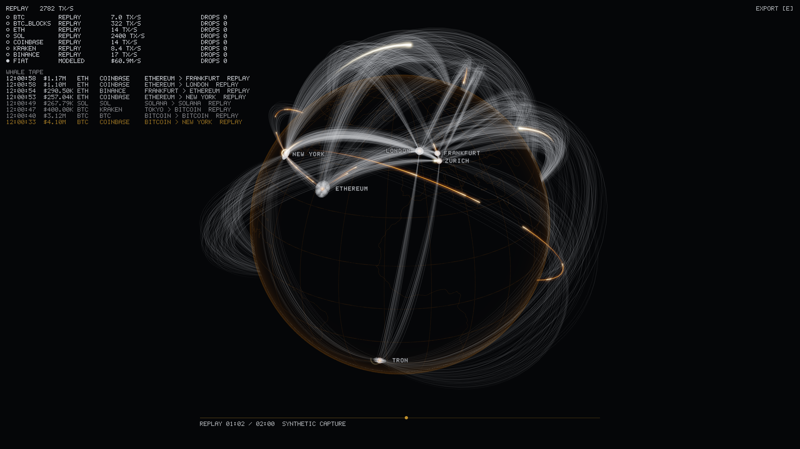

# ftviz

A C++20 / OpenGL 4.5 telemetry terminal for financial flows on a dark globe:
public crypto feeds and liquidations live, ECB reference rates, modeled fiat
corridors driven by trading sessions, a day/night terminator, submarine cable
geometry, search, a filtered tape and exports. One self-contained
executable: shaders, coastlines, configuration and the replay capture are
compiled in.



The images on this page are v3 frames. The v4 set (`hero_globe_v4.png`,
`cables_europe_asia.png`, `search_and_hub_panel.png`,
`whale_liquidation_tape.png`, `night_side_tokyo.png`) has not been rendered
yet: it needs the city-lights and cable datasets and a discrete GPU, see
[Not verified](#not-verified).

## Download and run (Windows)

Download `ftviz.exe` from the repository's **Releases** page and
double-click it. No installer, no DLLs beside it. Windows SmartScreen may
warn on first launch because the exe is unsigned.

Requirements: 64-bit Windows 10 or 11 and a driver with OpenGL 4.5. macOS
is not supported (OpenGL stops at 4.1). On Linux, build from source.

## Features

- **Globe.** Natural Earth coastlines, 15° graticule, amber atmosphere rim.
  Locked palette: Obsidian `#050608`, Amber `#C8962E`, Ink `#D9DCE1`, Neon
  Gold `#FFC23D` for whales and liquidations only, Night Lights `#E8A54B`,
  Day Tint `#0B0E13`. Only whales and liquidations bloom.
- **Day and night.** Subsolar point from the NOAA/Meeus solar equations
  (within 0.2° of astropy on six dates). The day side takes the Day Tint,
  coastlines drop to 50% at night, the rim brightens on the day side and
  warms along the terminator. `--sun-time` fixes the sun.
- **City lights.** NASA Black Marble, 2048×1024 BC4, log-toned, only where
  the surface is in darkness. Off until the dataset is built (below).
- **Submarine cables.** Hairline cable routes, Amber at alpha 0.10 to 0.16,
  one draw. Hub-to-hub flows follow a shortest path over the cable graph
  (Dijkstra) when one exists, else the great circle; such arcs are labelled
  `ROUTE · MODELED (cable geometry)`. They are not the paths packets take.
- **Post.** 8× MSAA, six-level Kawase bloom on the emissive target only,
  ACES tone map. No FXAA.
- **Live feeds.** Bitcoin, Ethereum and Solana (RPC pools of three public
  endpoints each), Coinbase, Kraken, Binance trades, Binance futures
  liquidations, OKX trades and liquidations, ECB rates. Every row is LIVE,
  DELAYED, MODELED or REPLAY. A feed refused for its region shows
  GEO_BLOCKED and is left alone.
- **Trading sessions.** Tokyo, London, New York and Shanghai: open, lunch,
  pre-market, closed and holidays from `config/sessions.json`, local times
  through `std::chrono` time zones. Chips in the HUD; fiat corridor
  intensity is the session factor times the BIS share.
- **Search.** `/` or `Ctrl+K`: fly to a hub or chain, filter by size, whale
  tier, venue or liquidations, find an address or transaction on the tape.
- **Tape.** Twelve rows, rate smoothed to 1 Hz, 10,000-row ring, filters as
  removable chips, click a row to fly to its hub.
- **Export.** Seven files per session, including the tape and liquidations.
- **Offline fallback.** A feed that stays down for 15 s is replaced by its
  records from the bundled capture, labelled REPLAY.
- **Fixed frame.** 23 draw calls per frame (9 scene, 14 post) whatever the
  data; zero heap allocations per frame on the render, model and layout
  threads, asserted in Debug builds.

## Gallery

v3 frames at 3840×2160 from the bundled synthetic capture.

| | |
|---|---|
|  |  |
| Hub panel, London pinned | Whales and flow trails |
|  |  |
| Graticule and coastlines | Replay timeline |

## Build

Requirements: CMake 3.20+, Git, a C++20 compiler (MSVC 2022, GCC 12+,
Clang 15+), OpenSSL 1.1.1+ (static for a standalone binary), Python 3 with
`jinja2`. FetchContent clones the pinned dependencies listed in
[THIRD_PARTY_NOTICES.md](THIRD_PARTY_NOTICES.md).

### Windows

Install Visual Studio 2022 with "Desktop development with C++", Git and
Python 3, then run `build.bat`. It installs `openssl:x64-windows-static`
through vcpkg, builds Release with `/MT`, runs the tests and copies the
result to `dist\ftviz.exe`. By hand:

```bat
vcpkg install openssl:x64-windows-static
cmake -S . -B build -G "Visual Studio 17 2022" -A x64 -DFTVIZ_WERROR=ON -DOPENSSL_ROOT_DIR=%VCPKG_ROOT%\installed\x64-windows-static
cmake --build build --config Release
ctest --test-dir build -C Release --output-on-failure
dumpbin /dependents build\Release\ftviz.exe
```

### Linux

```sh
sudo apt install libssl-dev libx11-dev libxrandr-dev libxinerama-dev libxcursor-dev libxi-dev libegl-dev python3-jinja2
cmake -S . -B build -DCMAKE_BUILD_TYPE=Release -DFTVIZ_WERROR=ON
cmake --build build -j
ctest --test-dir build --output-on-failure
```

| CMake option | Default | Effect |
|---|---|---|
| `FTVIZ_STATIC` | ON | Static runtime (`/MT`) and static OpenSSL |
| `FTVIZ_WIN32_GUI` | ON | Windows: no console window on double-click |
| `FTVIZ_BUILD_APP` | ON | OpenGL application and render test |
| `FTVIZ_BUILD_TESTS` | ON | `ftviz_tests` and `ftviz_render_tests` |
| `FTVIZ_BUILD_TOOLS` | ON | `gen_synthetic` and `gen_capture` |
| `FTVIZ_WERROR` | OFF | Warnings as errors |

Offline builds: `-DFETCHCONTENT_SOURCE_DIR_<NAME>=<path>` for `GLFW`,
`GLAD`, `GLM`, `XXHASH`, `SIMDJSON` and `STB`.

### Datasets

Two datasets are built by scripts and embedded when present:

```sh
python tools/build_cables.py cables.geojson assets/cables.bin           # stdlib only
python tools/build_citylights.py BlackMarble.tif assets/citylights.bin  # numpy, Pillow
```

`build_cables.py` simplifies each route with Douglas–Peucker on the sphere
(tolerance 5 km) and tags five corridors. `build_citylights.py` converts to
luminance, resizes to 2048×1024, log-tones and writes BC4 with mips. The
cable source must allow redistribution (see the notices file); the
TeleGeography map is CC BY-NC-SA and is not used.

### Configuration

Each file is looked up in this order, first match wins:

1. a CLI path (`--feeds`, `--theme`, ...) or `--data-dir`;
2. the user directory, `%APPDATA%\ftviz` on Windows,
   `$XDG_CONFIG_HOME/ftviz` or `~/.config/ftviz` elsewhere (skipped with
   `--no-user-config`);
3. the copy embedded in the exe.

The source of every non-embedded file is printed at startup.

## Usage

```sh
ftviz                                   # globe + live feeds
ftviz --no-live                         # modeled corridors only
ftviz --replay                          # bundled synthetic capture, seekable
ftviz --sun-time 2026-12-21T12:00:00Z   # fix the sun
ftviz --export out --export-after 60    # export after 60 s, then exit
```

| Input | Action |
|---|---|
| `/` or `Ctrl+K` | open search; `Up`/`Down` choose, `Enter` runs, `Esc` closes |
| Click a chip | remove that filter |
| Click a tape row | fly to its hub |
| Left drag / right drag / wheel | orbit / pan / zoom |
| Click a hub | pin its panel |
| `1` to `5` | camera presets |
| `E` or EXPORT | export |
| `Space` | pause |
| `Left` / `Right` (`Shift`: 10 s) | seek the replay |
| `H` | toggle the HUD |
| `Esc` | clear the pin, then quit |

Search grammar, one term per query, case-insensitive, filters combine:

| Query | Effect |
|---|---|
| `london`, `tokyo`, `ny` | fly to a hub (fuzzy) |
| `eth`, `btc`, `sol` | fly to a chain |
| `>10m`, `>250k` | minimum USD value |
| `whale:t2` | whale tier 2 or higher |
| `venue:okx` | one venue |
| `liq` | liquidations only |
| `addr:0x...` | find an address on the tape |
| `tx:...` | find a transaction on the tape |

## Data sources

| Source | Label | Endpoint |
|---|---|---|
| Bitcoin transactions | LIVE | `wss://ws.blockchain.info/inv` |
| Bitcoin blocks and mempool | LIVE | `wss://mempool.space/api/v1/ws` |
| Ethereum (pool) | LIVE | `ethereum-rpc.publicnode.com`, `eth.drpc.org`, `mainnet.gateway.tenderly.co` |
| Solana (pool) | DELAYED | `api.mainnet-beta.solana.com`, `solana-rpc.publicnode.com`, `solana.drpc.org` |
| Coinbase | LIVE | `wss://ws-feed.exchange.coinbase.com` |
| Kraken | LIVE | `wss://ws.kraken.com/v2` |
| Binance trades | LIVE | `wss://stream.binance.com:9443/stream` |
| Binance liquidations | LIVE | `wss://fstream.binance.com/ws/!forceOrder@arr` |
| OKX trades and liquidations | LIVE | `wss://ws.okx.com:8443/ws/v5/public` |
| FX rates | DELAYED | `https://api.frankfurter.dev/v1/latest` |
| Fiat corridors | MODELED | none: BIS Triennial Survey 2022 shares × session factor |
| Capture | REPLAY | embedded, synthetic (`tools/gen_capture.cpp`) |

- Public endpoints, no keys, TLS verification always on.
- Each pool endpoint has a token bucket at its published limit. A pool
  rotates on failure or bad health, never to get around a limit: when the
  active endpoint is at its limit, requests wait. Rotations are logged in
  the HUD and in `session.json`.
- When every configured URL of a feed refuses the region (HTTP 451, or 403
  at the upgrade), the feed shows GEO_BLOCKED and stays there. No proxies,
  no other routes.
- The pool limits and the exchange holidays in `config/sessions.json`
  carry `as_of: UNVERIFIED` until checked against each source.
- There is no real-time BIS feed. Fiat flows are modeled and labelled so.
- Latency is local receive time minus the provider's timestamp, clock skew
  included.

DESIGN_NOTES §11 and §16 cover rate limits, the state machine and pools.

## Export format

`ftviz_export_<UTC timestamp>/`, each file written to a temporary name and
renamed:

| File | Content |
|---|---|
| `session.json` | format `ftviz-export/2`: mode, feeds and state history, filters, sun time and subsolar point, trading sessions, endpoint pools and rotations, modeled corridors with source, counters |
| `hub_flows.csv` | `src_hub,dst_hub,currency,usd_volume,tx_count,source_label` |
| `hub_flows.json` | the same flows as `flows[src][dst][]` |
| `whales.csv` | `ts_utc,chain,asset,usd_value,tier,src,dst,source_label` |
| `volume_tps.csv` | `ts_utc,feed,tx_count,usd_volume` per second and feed |
| `tape.csv` | `ts_utc,venue,kind,asset,quote,side,usd_value,amount,price,tier,src,dst,from,to,source_label` |
| `liquidations.csv` | `ts_utc,venue,asset,quote,position,usd_value,amount,price,tier,source_label` |

Times are ISO 8601 UTC; CSV follows RFC 4180.

## Performance

Rendering at 1440p: **not yet measured on discrete GPU.** Every pass has a
GPU timer (globe, atmosphere, coast, cables, nodes, arcs, whales, hubs,
pick, bloom, post, HUD); the only renderer available so far was Mesa
llvmpipe, whose numbers say nothing about GPU frame rates.

Ingest and layout (v2, 4-vCPU Xeon @ 2.10 GHz, GCC 13.3, 10M rows): parse
3.37M rows/s, whole stage 3.93 s, layout at 1M nodes 277 ms per iteration.

## Tests

```sh
ctest --test-dir build --output-on-failure
```

- `ftviz_tests`, 99 tests, no GPU, no network: ingest, layout, parsers for
  every feed against fixtures in the documented formats (Binance
  forceOrder, OKX trades, liquidations, errors), the feed state machine
  including GEO_BLOCKED and the 15 s fallback, endpoint pool buckets and
  rotation, solar position against astropy, time zones and sessions (DST,
  lunch, holidays), the search grammar, cable routing, BC4, export golden
  files.
- `ftviz_render_tests`, 9 cases, offscreen: palette, Day Tint, city lights
  only at night and not emissive, cable hairlines, constant draw count, hue
  clusters, emissive only on whales.

## Verification

| Check | Result |
|---|---|
| Linux, GCC 13, Release, `FTVIZ_WERROR=ON` | clean; 99/99 unit, 9/9 render (Mesa llvmpipe) |
| Debug zero-allocation assertion | 0 per frame on render, model and layout threads, replay and live-fallback |
| Export, replay mode | 7 files; LSE OPEN and NYSE PRE at the capture time |

### Not verified

- MSVC `/MT` build of v4, `dumpbin`, exe size and SHA-256.
- Frame rates on a discrete GPU, and 8× MSAA (llvmpipe caps at 4×).
- Live feeds, including the new Binance liquidation, OKX and pool feeds.
- City lights and cables: the datasets are not embedded yet.
- Pool rate limits and exchange holidays against their sources.

## Attribution

Coastlines: [Natural Earth](https://www.naturalearthdata.com/) v5.1.2,
public domain. Fiat corridor shares: BIS Triennial Central Bank Survey 2022.
Licenses of every library and dataset: [THIRD_PARTY_NOTICES.md](THIRD_PARTY_NOTICES.md).
Design and measurements: [DESIGN_NOTES.md](DESIGN_NOTES.md).
