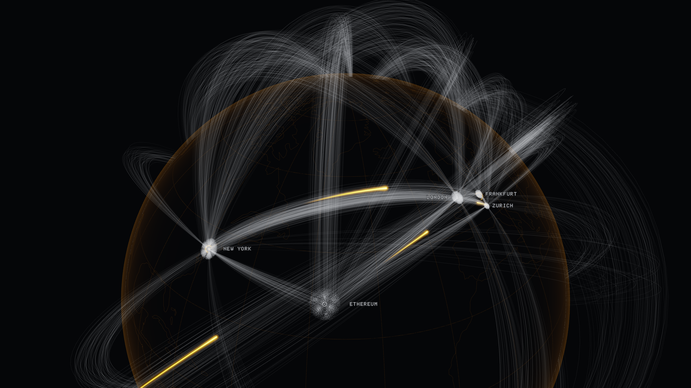

# ftviz

A C++20 / OpenGL 4.5 visualizer for financial flows on a dark globe:
transaction graphs from a file, public crypto feeds live, modeled fiat
corridors, and the largest transfers in gold.


## Features

- **Globe.** Natural Earth coastlines, a 15° graticule and a thin amber
  rim. Arcs fade with depth and are hidden behind the globe.
- **Four colours.** Obsidian `#050608`, amber `#C8962E`, ink `#D9DCE1`, and
  neon gold `#FFC23D` for whales only. Only whales glow.
- **Live feeds.** Bitcoin, Ethereum, Solana, Coinbase and Kraken over
  public WebSocket endpoints, each with a state, a rate and a drop count
  on screen.
- **Honest labels.** Every source is LIVE, DELAYED, MODELED or REPLAY
  wherever it appears: HUD, hub panel, exports.
- **Replay.** A capture plays on a seekable timeline. A feed that is down
  for 15 s falls back to it and says so.
- **Export.** One key writes the session to five CSV and JSON files.
- **Interaction.** Hover and pin hubs, five camera presets, pause, scrub.
- **Fixed frame.** 8 scene draws and 8 post draws per frame whatever the
  data; no `glDrawElements`; zero heap allocations per frame on the
  render, model and layout threads (asserted in Debug builds).
- **Deterministic screenshots.** `--screenshot` renders offscreen; the
  same command gives the same bytes.

## Gallery

Engine frames at 3840×2160, from the commands under
[Screenshots](#screenshots). The capture they replay is synthetic.

| | |
|---|---|
|  |  |
| Hub panel, London pinned | Whale transfers in flight |
|  |  |
| Graticule and coastlines | Replay timeline |

## Build

Requirements:

- CMake 3.20 or newer and Git (FetchContent clones the pinned
  dependencies: GLFW 3.4, glad 2.0.8, GLM 1.0.1, xxHash 0.8.3,
  simdjson 3.10.1 and stb_image_write).
- OpenSSL 1.1.1 or newer (`libssl-dev`), for the TLS feeds.
- A C++20 compiler: MSVC 2022, GCC 12+ or Clang 15+.
- For the application: Python 3 with `jinja2` (glad generates its loader at
  build time) and an OpenGL 4.5 driver. 4.3 also works with
  `ARB_direct_state_access`, `ARB_buffer_storage` and `ARB_clip_control`.

### Linux

```sh
sudo apt install libssl-dev libx11-dev libxrandr-dev libxinerama-dev libxcursor-dev libxi-dev libegl-dev
cmake -S . -B build -DCMAKE_BUILD_TYPE=Release
cmake --build build -j
ctest --test-dir build --output-on-failure
```

`libegl-dev` is optional. With it, `--screenshot` and the render test use a
surfaceless EGL context and need no display; without it they open a hidden
window.

### Windows (Visual Studio 2022)

```bat
cmake -S . -B build -G "Visual Studio 17 2022" -A x64
cmake --build build --config Release
ctest --test-dir build -C Release --output-on-failure
```

`shaders/`, `config/` and `assets/` are copied next to the `ftviz` binary, so it runs
from the build directory.

| CMake option | Default | Effect |
|---|---|---|
| `FTVIZ_BUILD_APP` | ON | OpenGL application and render test |
| `FTVIZ_BUILD_TESTS` | ON | `ftviz_tests` (no GPU needed) and `ftviz_render_tests` |
| `FTVIZ_BUILD_TOOLS` | ON | `gen_synthetic` and `gen_capture` generators |
| `FTVIZ_WERROR` | OFF | Treat warnings as errors |
| `FTVIZ_NATIVE` | OFF | `-march=native` |
| `FTVIZ_GLFW_WAYLAND` | OFF | Build GLFW with Wayland support on Linux |

To build without network access, point FetchContent at local checkouts with
`-DFETCHCONTENT_SOURCE_DIR_<NAME>=<path>` for `GLFW`, `GLAD`, `GLM`,
`XXHASH`, `SIMDJSON` and `STB`. `-DFTVIZ_BUILD_APP=OFF` builds the ingest, model,
layout and their tests without any GL dependency.

## Usage

```sh
./build/gen_synthetic --rows 300000 --out tx.csv --seed 42
./build/ftviz --input tx.csv --prelayout 300              # graph + modeled corridors
./build/ftviz --input tx.csv --live                       # public feeds
./build/ftviz --input tx.csv --replay                     # bundled capture, seekable
./build/ftviz --input tx.csv --live --export out --export-after 60   # export after 60 s, exit
```

`--input` is always required: the transaction graph is the scene's base
layer. `./build/ftviz --help` lists every option.

| Input | Action |
|---|---|
| Left drag / right drag / wheel | orbit / pan / zoom |
| Hover a hub | highlight it |
| Click a hub | pin its panel |
| Click a node | select it and its 1-hop neighbourhood |
| `1` to `5` | view presets: globe, Americas, Europe, Asia, chain shell (1.2 s flight) |
| `E` or the EXPORT button | export |
| `Space` | pause or resume ingest, layout and clocks |
| `Left` / `Right` | seek the replay 1 s; with `Shift`, 10 s |
| Drag the timeline | scrub the replay |
| `F` | frame the selection |
| `D` | toggle inter-hub edge detail |
| `L` / `R` | pause the layout / reheat it |
| `H` | toggle the HUD |
| `Esc` | clear the pin or selection, then quit |

Configuration, all with `//` comments allowed:

- `config/hubs.json`: hubs, jurisdiction map, force constants.
- `config/render.json`: window, edge budgets, globe, replay, camera.
- `config/theme.json`: the four colours and every alpha and width.
- `config/feeds.json`: endpoints, labels, request limits, whale thresholds.
- `config/flows_baseline.csv`: the modeled fiat corridors and their source.

### Input format

CSV with a header; columns are matched by name, in any order:

```
tx_id,timestamp_utc,src_account,dst_account,amount,currency,channel,src_jurisdiction,dst_jurisdiction,chain
```

Channels are `SWIFT SEPA ACH FEDWIRE CHAPS ZENGIN ONCHAIN INTERNAL`.
Timestamps are ISO-8601 UTC or epoch milliseconds. Amounts are parsed as
fixed-point decimals in the currency's minor units. A malformed row is
counted and its offset logged; it never stops the run. `.ftxb` is the same
data as fixed 64-byte records plus a string pool
(`src/ingest/ftxb_format.hpp`).

### Screenshots

```sh
./build/gen_synthetic --rows 300000 --out s300k.csv --seed 42
C="--dataset s300k.csv --prelayout 300 --ui-scale 2 --width 3840 --height 2160 --warmup-frames 4 --replay"
D=docs/screenshots
./build/ftviz $C --camera globe --overlay --time 62 --screenshot $D/hero_globe.png
./build/ftviz $C --camera hub:LONDON --overlay --pin LONDON --time 90 --screenshot $D/hub_panel_london.png
./build/ftviz $C --camera whale --screenshot $D/whale_event.png
./build/ftviz $C --camera graticule --screenshot $D/graticule_coastline.png
./build/ftviz $C --camera globe --overlay --time 100 --paused --screenshot $D/replay_timeline.png
```

Each image was rendered twice and the files were byte-identical. They were
rendered with 4× MSAA, the driver's maximum on the capture machine; the
renderer requests 8× and uses the driver's maximum when it is lower.

## Data sources

| Source | Label | Endpoint | What is shown |
|---|---|---|---|
| Bitcoin transactions | LIVE | `wss://ws.blockchain.info/inv` | unconfirmed transactions |
| Bitcoin blocks | LIVE | `wss://mempool.space/api/v1/ws` | block headers and transaction counts |
| Ethereum | LIVE | `wss://ethereum-rpc.publicnode.com` | transfers in each new block |
| Solana | DELAYED | `api.mainnet-beta.solana.com` | up to 32 sampled transfers per block, 32 slots behind the tip |
| Coinbase | LIVE | `wss://ws-feed.exchange.coinbase.com` | trades (`matches`) |
| Kraken | LIVE | `wss://ws.kraken.com/v2` | trades |
| Fiat corridors | MODELED | none | flat per-second flows derived from BIS Triennial Survey 2022 shares |
| Capture | REPLAY | `assets/replay/default.ftxcap` | `--replay`, or any feed that has been down for 15 s |

- The endpoints are public and need no key. TLS verification is always on.
- Fiat flows are never observed. They are a model and are labelled MODELED.
- The bundled capture is **synthetic**, generated by `tools/gen_capture.cpp`
  with a fixed seed. It is not recorded market data, and the timeline and
  `session.json` say so.
- USD values use prices from the same feeds. Trades in EUR, GBP or JPY are
  valued through the cross rate implied by the same exchange.
- Exchange trades are drawn between the chain hub and the hub of the quote
  currency's home market (USD: New York, EUR: Frankfurt, GBP: London, JPY:
  Tokyo). This is a display convention, not a statement of where the
  counterparties are.
- Solana USD volume covers the sampled transfers only; nothing is
  extrapolated.

Rate limits and the state machine are in DESIGN_NOTES §11.

## Export format

An export is a directory `ftviz_export_<UTC timestamp>` with five files,
each written to a temporary name and renamed:

| File | Columns or content |
|---|---|
| `session.json` | format, version, git SHA, start and end UTC, mode, capture, label definitions, feeds (URL, label, state history, events, drops, USD total), modeled corridors with source URL, counters |
| `hub_flows.csv` | `src_hub,dst_hub,currency,usd_volume,tx_count,source_label` |
| `hub_flows.json` | the same flows nested as `flows[src][dst][]` |
| `whales.csv` | `ts_utc,chain,asset,usd_value,tier,src,dst,source_label` |
| `volume_tps.csv` | `ts_utc,feed,tx_count,usd_volume`, one row per second and feed; the feed name carries any label other than LIVE |

Times are ISO 8601 UTC. CSV follows RFC 4180. Modeled corridors have
`tx_count` 0 because no counts are published.

## Performance

Measured on a 4-vCPU cloud VM (Intel Xeon @ 2.10 GHz), GCC 13.3, Release.

Ingest and layout, 10M-row synthetic dataset (1,121 MB, 998,146 entities,
7.76M aggregated edges):

| Stage | Result |
|---|---|
| Ingest, parse phase (2 parser threads) | 3.37M rows/s, 378 MB/s |
| Ingest, whole stage | 3.93 s (2.55M rows/s) |
| Graph build | 513 ms |
| Layout at 1M nodes, 4 threads | 277 ms per iteration (mean of 20; p95 315 ms) |

Rendering: **not yet measured on discrete GPU.** The only renderer
available was Mesa llvmpipe, a software rasteriser. On it, at 2560×1440
with 4× MSAA and the 300,000-row dataset, a v2 frame took 404.9 ms mean
(p95 477.7 ms, 50 frames) against 331.2 ms for v1 (110 frames). Per-pass
timings are in DESIGN_NOTES §10.1. These numbers do not predict GPU frame
rates.

Allocations, Debug build, 110 frames in `--replay`: 0 on the render thread
in our code, 0 on the model thread.

## Tests

```sh
ctest --test-dir build --output-on-failure
```

- `ftviz_tests` (81 tests, no GPU, no network): ingest, layout, feed
  parsers against hand-written fixtures in the providers' documented
  formats, rings, backoff, the feed state machine and fallback, model determinism and seek, export golden files,
  picking and camera presets.
- `ftviz_render_tests` (5 cases, offscreen): background colour, hue
  clusters, emissive only on whales, coastline pixels, atmosphere rim,
  a live whale arc. It
  reports SKIP without an OpenGL 4.5 context.

Live feeds are not exercised by the tests.

## Attribution

Coastlines: made with [Natural Earth](https://www.naturalearthdata.com/),
release v5.1.2, 1:110m and 1:50m coastline layers. Public domain.

Fiat corridor shares: BIS Triennial Central Bank Survey 2022, "OTC foreign
exchange turnover in April 2022".

[DESIGN_NOTES.md](DESIGN_NOTES.md) covers threading, memory layout, the
renderer, live data, export and every measurement.
