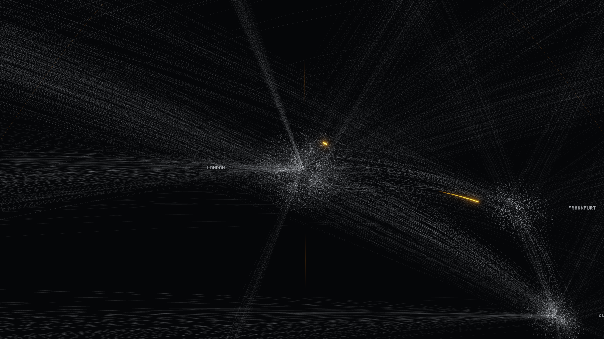
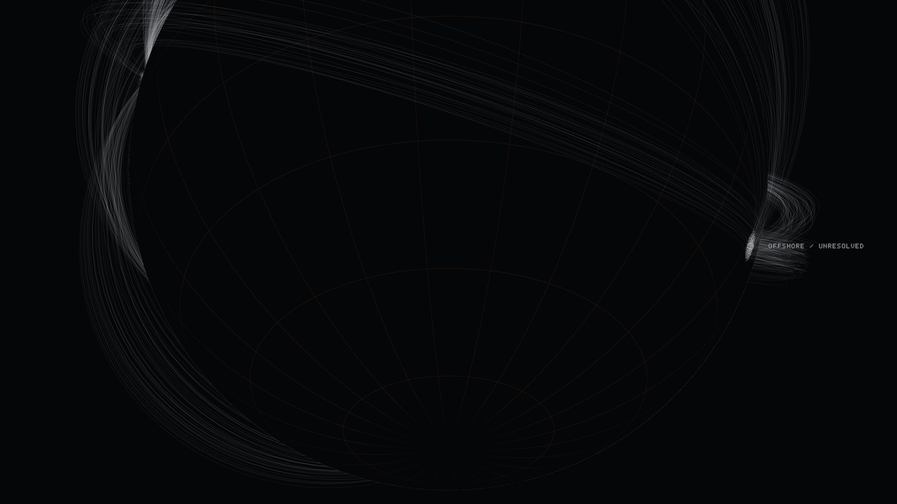
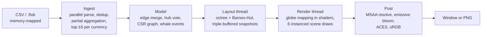

# ftviz

A C++20 / OpenGL 4.5 renderer for large financial transaction graphs: ten
million transactions, one million entities, drawn as hairline flows across a
dark globe with the largest transfers in gold.


## Features

- **Ingest at memory speed.** A memory-mapped CSV or packed `.ftxb` file is
  parsed by parallel workers with no per-row allocation: 3.37M rows/s on a
  4-vCPU VM (see [Performance](#performance)).
- **Deterministic layout.** A parallel Barnes-Hut force solver with SIMD
  kernels arranges every entity around its hub and gives a bit-identical
  result for any thread count.
- **Geographic globe.** Fiat centres sit at their cities' coordinates, chain
  networks at fixed points in open ocean. Flows between hubs are lifted
  great-circle arcs.
- **Four colours.** Obsidian background, amber 15° graticule, ink for nodes,
  arcs and labels, and gold reserved for whale transfers. Nothing is
  coloured per hub or per currency.
- **Whale replay.** The 16 largest transactions of each currency travel
  their arcs on a looping replay timeline, written to an emissive buffer and
  bloomed on their own.
- **Constant draw sequence.** Six instanced scene draws and a fixed
  fullscreen post chain per frame, whatever the graph size. No
  `glDrawElements`, no per-frame buffer re-specification, zero heap
  allocations on the render thread (asserted in Debug builds).
- **Offscreen screenshots.** `--screenshot` renders a frame without a
  window and writes a PNG; the same command gives the same pixels.

## Gallery

All four images are engine frames at 3840×2160, rendered with the commands
under [Screenshots](#screenshots).

| | |
|---|---|
|  |  |
| London close-up (`--camera london`) | Whale transfers in flight (`--camera whale`) |
|  | |
| Graticule detail (`--camera graticule`) | |

## Architecture



| Stage | Source | Notes |
|---|---|---|
| Ingest | `src/ingest/` | 16 MB chunks through a bounded MPMC queue; worker-private hash tables merged into a 64-shard registry; exact 128-bit sums. |
| Model | `src/model/` | Hub assignment by majority vote, bridge detection, CSR adjacency, whale events mapped to replay time. |
| Layout | `src/layout/` | Morton-sorted octree rebuilt every iteration, grouped SIMD repulsion, springs and anchors; runs on its own thread. |
| Render | `src/render/` | Persistently mapped rings behind fences, reverse-Z infinite projection, RGBA16F scene and emissive targets, dual-filter bloom. |
| App | `src/app/` | CLI, configuration, camera presets, viewer loop, screenshot path, headless benchmark. |

[DESIGN_NOTES.md](DESIGN_NOTES.md) covers the threading model, memory
layout, hashing, force model, renderer and measurements in detail.

## Build

Requirements:

- CMake 3.20 or newer and Git (FetchContent clones the pinned
  dependencies: GLFW 3.4, glad 2.0.8, GLM 1.0.1, xxHash 0.8.3 and
  stb_image_write).
- A C++20 compiler: MSVC 2022, GCC 12+ or Clang 15+.
- For the application: Python 3 with `jinja2` (glad generates its loader at
  build time) and an OpenGL 4.5 driver. 4.3 also works with
  `ARB_direct_state_access`, `ARB_buffer_storage` and `ARB_clip_control`.

### Linux

```sh
sudo apt install libx11-dev libxrandr-dev libxinerama-dev libxcursor-dev libxi-dev libegl-dev
cmake -S . -B build -DCMAKE_BUILD_TYPE=Release
cmake --build build -j
ctest --test-dir build --output-on-failure
```

`libegl-dev` is optional. With it, `--screenshot` and the render test use a
surfaceless EGL context and need no display; without it they open a hidden
window.

### Windows (Visual Studio 2022)

```bat
cmake -S . -B build -G "Visual Studio 17 2022" -A x64
cmake --build build --config Release
ctest --test-dir build -C Release --output-on-failure
```

`shaders/` and `config/` are copied next to the `ftviz` binary, so it runs
from the build directory.

| CMake option | Default | Effect |
|---|---|---|
| `FTVIZ_BUILD_APP` | ON | OpenGL application and render test |
| `FTVIZ_BUILD_TESTS` | ON | `ftviz_tests` (no GPU needed) and `ftviz_render_tests` |
| `FTVIZ_BUILD_TOOLS` | ON | `gen_synthetic` data generator |
| `FTVIZ_WERROR` | OFF | Treat warnings as errors |
| `FTVIZ_NATIVE` | OFF | `-march=native` |
| `FTVIZ_GLFW_WAYLAND` | OFF | Build GLFW with Wayland support on Linux |

To build without network access, point FetchContent at local checkouts with
`-DFETCHCONTENT_SOURCE_DIR_<NAME>=<path>` for `GLFW`, `GLAD`, `GLM`,
`XXHASH` and `STB`. `-DFTVIZ_BUILD_APP=OFF` builds the ingest, model,
layout and their tests without any GL dependency.

## Usage

Generate a dataset and open it:

```sh
./build/gen_synthetic --rows 10000000 --out tx10m.csv --seed 42
./build/ftviz --input tx10m.csv --prelayout 300
```

The layout keeps running while the window is open. The replay clock starts
at once and loops every 120 s (`replay_seconds` in `config/render.json`).

| Input | Action |
|---|---|
| Left drag | orbit |
| Right or middle drag | pan |
| Wheel | zoom |
| Click | select a node and highlight its 1-hop neighbourhood |
| `1` to `9` | fly to hub 1 to 9 |
| `0` | overview |
| `F` | frame the selection |
| `E` | toggle inter-hub arcs |
| `Space` | pause or resume the replay |
| `L` / `R` | pause the layout / reheat it |
| `H` | toggle the HUD |
| `Esc` | clear the selection, or quit |

Other modes:

```sh
./build/ftviz --input tx10m.csv --headless --layout-iters 50     # ingest + layout benchmark, no window
./build/ftviz --input tx10m.csv --frames 600                     # exit after 600 frames, print frame times
```

`./build/ftviz --help` lists every option. Configuration lives in three
files, all of which accept `//` comments:

- `config/hubs.json`: hubs (layout anchor, globe coordinates, footprint,
  label side), the jurisdiction-to-hub map and the force constants.
- `config/render.json`: window, edge budgets, globe, replay and camera.
- `config/theme.json`: the four colours and every alpha, width and
  intensity, clamped to the ranges noted in the file.

### Input format

CSV with a header; columns are matched by name, in any order:

```
tx_id,timestamp_utc,src_account,dst_account,amount,currency,channel,src_jurisdiction,dst_jurisdiction,chain
```

Channels are `SWIFT SEPA ACH FEDWIRE CHAPS ZENGIN ONCHAIN INTERNAL`.
Timestamps are ISO-8601 UTC or epoch milliseconds. Amounts are parsed as
fixed-point decimals in the currency's minor units. A malformed row is
counted and its offset logged; it never stops the run. `.ftxb` is the same
data as fixed 64-byte records plus a string pool
(`src/ingest/ftxb_format.hpp`).

### Screenshots

The gallery was produced with these commands, from a 300,000-row synthetic
dataset with seed 42:

```sh
./build/gen_synthetic --rows 300000 --out s300k.csv --seed 42
for p in hero_globe:globe hub_closeup_london:london whale_event:whale graticule_detail:graticule; do
  ./build/ftviz --dataset s300k.csv --prelayout 300 --camera ${p#*:} --ui-scale 2 \
    --width 3840 --height 2160 --warmup-frames 4 --screenshot docs/screenshots/${p%%:*}.png
done
```

Each run prints an XXH3 digest of the pixels. Rendering every image twice
gave identical digests and byte-identical files. The images here were
rendered with 4× MSAA, the most the driver on the capture machine offered;
the renderer requests 8× and uses the driver's maximum when it is lower.

## Performance

Measured on a 4-vCPU cloud VM (Intel Xeon @ 2.10 GHz, AVX-512), GCC 13.3,
Release with LTO, on a 10M-row synthetic dataset (1,121 MB, 998,146
entities, 7.76M aggregated edges):

| Stage | Result |
|---|---|
| Ingest, parse phase (2 parser threads) | 3.37M rows/s, 378 MB/s |
| Ingest, whole stage | 3.93 s (2.55M rows/s) |
| Graph build | 513 ms |
| Layout at 1M nodes, 4 threads | 277 ms per iteration (mean of 20; p95 315 ms) |
| Layout snapshot upload at 1M nodes | 0.70 ms per frame mean (≤ 4 MiB per frame) |

Frame rates on a discrete GPU have not been measured yet. DESIGN_NOTES §10
lists every measurement and the targets that remain open, including the
layout's 50 ms per iteration goal on 8 cores.

## Tests

```sh
ctest --test-dir build --output-on-failure
```

- `ftviz_tests` (37 tests, no GPU): hashing, CSV and field parsers,
  aggregation and its thread-count independence, whale selection, hub
  assignment, octree accuracy against brute force, layout determinism and
  the core concurrency primitives.
- `ftviz_render_tests`: renders real frames offscreen and checks that the
  background is within ±2 of `#050608`, that the frame holds at most four
  hue clusters, and that emissive pixels appear only on active whale arcs
  and flashes. It reports SKIP where no OpenGL 4.5 context is available.
