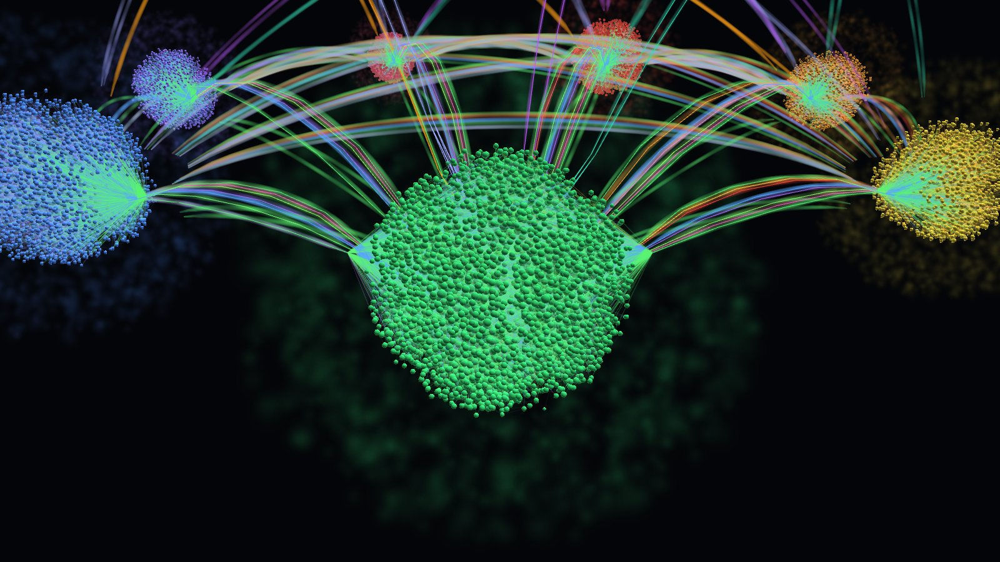
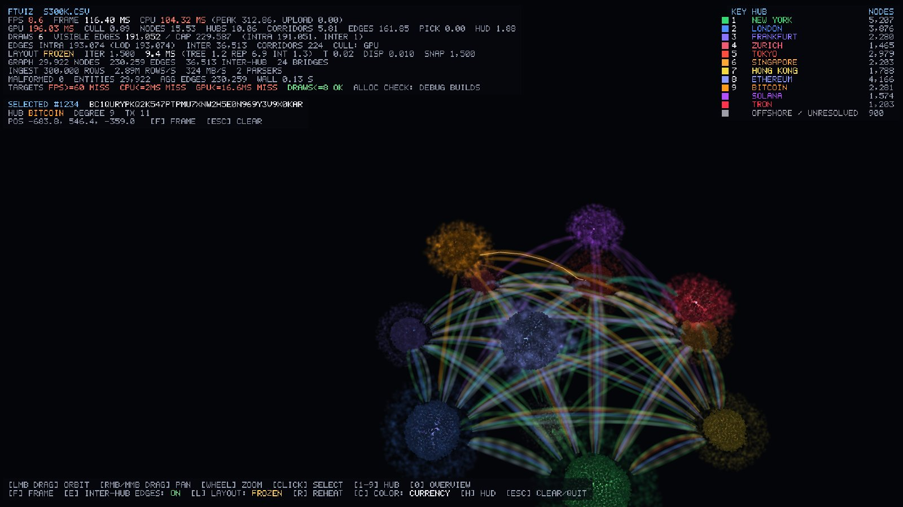

# ftviz: 3D financial transaction visualizer

ftviz ingests tens of millions of transactions from a local CSV or `.ftxb`
file, aggregates them into an entity graph, lays the graph out around
geographic and on-chain "hubs" with a parallel Barnes-Hut force solver, and
renders it with OpenGL 4.5. Everything runs offline. The program does no
network I/O; only the build fetches its four pinned dependencies.


The fiat centres (New York, London, Frankfurt, Zurich, Tokyo, Singapore, Hong
Kong) sit on a ring at y = 0. The chain clouds (Ethereum, Bitcoin, Solana,
Tron) sit on a higher, phase-shifted ring, and `OFFSHORE_UNRESOLVED` sits
below the centre. Inter-hub flows are drawn as bundled Bézier corridors, one
lane per (hub pair, currency).

| New York close-up | Selection with the HUD |
|---|---|
|  |  |

All screenshots were rendered with Mesa llvmpipe, a software rasteriser, on
a virtual display. The HUD timings in them describe that software
rasteriser, not a GPU.

See [DESIGN_NOTES.md](DESIGN_NOTES.md) for the architecture, the memory layout,
the force model and the measured performance.

## Build

Requirements:

- CMake 3.20 or newer and Git (FetchContent clones the dependencies).
- A C++20 compiler: MSVC 2022, GCC 12+ or Clang 15+.
- For the application only:
  - Python 3 with `jinja2` (`pip install jinja2`), because the glad 2
    loader is generated at build time.
  - An OpenGL 4.5 driver. 4.3 also works when the ARB extensions listed in
    DESIGN_NOTES are present.
  - On Linux, the X11 development packages GLFW needs, for example
    `libx11-dev libxrandr-dev libxinerama-dev libxcursor-dev libxi-dev`.

Linux or macOS with Ninja or Makefiles:

```sh
cmake -S . -B build -DCMAKE_BUILD_TYPE=Release
cmake --build build -j
ctest --test-dir build --output-on-failure      # or ./build/ftviz_tests
```

Windows with Visual Studio 2022:

```bat
cmake -S . -B build -G "Visual Studio 17 2022" -A x64
cmake --build build --config Release
ctest --test-dir build -C Release --output-on-failure
```

Release builds use `-O3` (or `/O2`) with link-time optimisation when the
toolchain supports it. `shaders/` and `config/` are copied next to the
`ftviz` binary, so it runs from the build directory.

| CMake option | Default | Effect |
|---|---|---|
| `FTVIZ_BUILD_APP` | ON | OpenGL application (fetches GLFW 3.4 and glad v2.0.8) |
| `FTVIZ_BUILD_TESTS` | ON | `ftviz_tests` unit tests (needs no GPU) |
| `FTVIZ_BUILD_TOOLS` | ON | `gen_synthetic` data generator |
| `FTVIZ_WERROR` | OFF | Treat warnings as errors (`-Werror` or `/WX`) |
| `FTVIZ_NATIVE` | OFF | `-march=native` (non-portable binaries) |
| `FTVIZ_GLFW_WAYLAND` | OFF | Build GLFW with Wayland support on Linux |

The pinned dependencies are GLFW 3.4, glad v2.0.8 (GL 4.5 core plus five
ARB/KHR extensions), GLM 1.0.1 and xxHash 0.8.3. To build without network
access, point FetchContent at local checkouts, for example
`-DFETCHCONTENT_SOURCE_DIR_GLFW=/src/glfw`. The other variables are
`FETCHCONTENT_SOURCE_DIR_GLAD`, `FETCHCONTENT_SOURCE_DIR_GLM` and
`FETCHCONTENT_SOURCE_DIR_XXHASH`.

A headless machine can build and test everything but the window:
`-DFTVIZ_BUILD_APP=OFF` needs no GL, GLFW or Python.

## Generate data

```sh
./build/gen_synthetic --rows 10000000 --out tx10m.csv                     # ~1.2 GB, ~1M entities
./build/gen_synthetic --rows 10000000 --out tx10m.ftxb                    # same data, packed binary
./build/gen_synthetic --rows 300000 --out small.csv --malformed-rate 0.0001 --crlf
```

| Option | Meaning |
|---|---|
| `--rows N` | number of transactions (default 1,000,000) |
| `--entities M` | population size (default rows / 10, at least 2,000) |
| `--seed S` | RNG seed (default 42); output is deterministic per seed |
| `--format csv\|ftxb` | output format (default: from the file extension) |
| `--malformed-rate R` | fraction of deliberately broken rows |
| `--crlf` | Windows line endings |

The generator models corporate and correspondent communities in each fiat
region and address communities on ETH, BTC, SOL and TRON. Exchanges appear
under one custodial id on fiat rails and on chain, so ftviz detects them as
bridges. There is also an offshore population with unmapped jurisdictions.
Activity is power-law skewed, and repeat counterparties give the aggregated
edges realistic counts.

## Run

```sh
./build/ftviz --input tx10m.csv                     # ingest, then lay out live while rendering
./build/ftviz tx10m.ftxb --prelayout 300            # settle the layout before the window opens
./build/ftviz --input tx10m.csv --headless --layout-iters 50     # ingest + layout benchmark, no window
./build/ftviz --input small.csv --prelayout 1500 --hub 1 --screenshot ny.ppm
```

The console prints an ingest report: rows/s, MB/s, entities, edges,
malformed rows with the first K byte offsets, and per-phase timings. A model
report follows with hub populations, bridges, inter-hub share and corridor
bundles. Headless runs add per-phase layout statistics (mean, p50, p95, max),
the convergence iteration and a determinism checksum.

Configuration lives in two files:

- `config/hubs.json` holds the hubs (id, display name, type, anchor, radius,
  colour, `k_anchor`), the jurisdiction-to-hub map and every force constant.
- `config/render.json` holds the window, the edge budget and LOD, the
  appearance and the camera.

Both files accept `//` comments.

### Input format

The CSV must have a header. Columns are matched by name, may appear in any
order, and extra columns are ignored:

```
tx_id,timestamp_utc,src_account,dst_account,amount,currency,channel,src_jurisdiction,dst_jurisdiction,chain
```

Field rules:

- **Channel**: one of `SWIFT SEPA ACH FEDWIRE CHAPS ZENGIN ONCHAIN INTERNAL`.
- **Timestamps**: ISO-8601 UTC (`2024-03-01T12:34:56.789Z`) or epoch
  milliseconds.
- **Amounts**: parsed as fixed-point decimals into int64 minor units. The
  scale depends on the currency (JPY 0, USD 2, BTC 8, ETH 9 and so on).
- **Quoting**: RFC 4180 quoting, CRLF line endings and a UTF-8 BOM are
  accepted.

A malformed row is counted, and the first K byte offsets are logged. A bad
row never aborts the run.

`.ftxb` is the binary form of the same data:

- a 64-byte header;
- N fixed 64-byte records holding timestamp, amount, currency, channel,
  jurisdictions, chain and string-pool references;
- a string pool with the raw identifiers.

The exact layout is in `src/ingest/ftxb_format.hpp`.

## Controls

| Input | Action |
|---|---|
| Left drag | orbit |
| Right or middle drag | pan |
| Wheel | zoom (dolly toward the orbit centre) |
| Click | select the node under the cursor (GPU pick); highlights its 1-hop neighbourhood |
| `1` to `9` | fly to hub 1 to 9 (legend order) |
| `0` | overview |
| `F` | frame the selection and its 1-hop neighbours |
| `E` | toggle individual inter-hub edges (corridors stay visible) |
| `L` | pause or resume the layout |
| `R` | reheat the layout |
| `C` | colour edges by currency or by channel |
| `H` | toggle the HUD |
| `Esc` | clear the selection; quits when nothing is selected |

The HUD shows:

- FPS, frame time and CPU time per frame;
- GPU time per pass, from `GL_TIME_ELAPSED` queries;
- draw calls and visible edges against the budget;
- layout state and per-phase timings;
- ingest statistics;
- a `TARGETS` line that checks the run against the spec's budgets: 60 FPS,
  2 ms CPU, 16.6 ms GPU, at most 8 draws, zero allocations per frame, and
  50 ms per layout iteration.

## Command line

```
--input PATH           CSV with header or packed .ftxb file (also accepted as a positional argument)
--format auto|csv|ftxb input format (default: auto-detect)
--hubs PATH            hub taxonomy (default: config/hubs.json next to the binary)
--render PATH          render settings (default: config/render.json next to the binary)
--shaders DIR          GLSL directory (default: shaders/ next to the binary)
--threads N            layout/merge threads incl. the coordinator (default: all cores headless,
                       all cores but one interactive, so the render thread keeps a core)
--parser-threads N     T_ingest workers (default: max(1, hw-2))
--chunk-mb N           ingest chunk size in MB (default 16)
--log-malformed K      print the first K malformed row offsets (default 8, max 16)
--headless             ingest + layout benchmark without a window
--layout-iters N       headless: run N iterations (default: until converged, max 5000)
--prelayout N          run N layout iterations before opening the window
--screenshot FILE.ppm  render, save the frame as binary PPM and exit (layout frozen)
--frames N             exit after N frames and print frame-time statistics
--width W --height H   window size (default from render.json)
--vsync | --no-vsync   override render.json
--msaa N               MSAA samples (1 = off)
--hub N                start focused on hub N (1-based)
--select NODE          start with node NODE (dense index) selected and framed
--camera Y,P,D         start camera yaw/pitch in degrees and distance
--no-detail            start with individual inter-hub edges hidden (toggle: E)
--paused               start with the layout paused (toggle: L)
--no-hud               start with the HUD hidden (toggle: H)
--no-gl-debug          do not request a debug context
--no-alloc-assert      Debug builds: warn instead of abort on per-frame allocations
```

Debug builds count heap allocations on the render thread and abort if a
frame allocates. Allocations a GL driver makes inside GL calls, such as
Mesa's LLVM shader compiler, are reported separately and do not trigger the
abort. DESIGN_NOTES explains why.

## Tests

`ftviz_tests` has 36 tests and needs no GPU or window. It covers:

- **Hashing**: the documented XXH3 formula and seeds, normalisation, and
  namespace separation, including custodial ids shared between fiat and
  chain.
- **CSV and field parsers**: BOM, CRLF, quotes, reordered and extra columns,
  missing columns, structurally broken rows, fixed-point amounts, timestamps
  (including impossible dates such as Feb 31) and packed codes.
- **Aggregation**: sums, counts and first/last timestamps; malformed rows;
  identical results for any thread count or chunk size; `.ftxb` matching the
  CSV semantics.
- **Hub assignment**: majority vote, ties, fallback and bridges.
- **Octree vs brute force**: under 2% relative error at θ = 0.8 (0.70%
  measured), exact at θ = 0, structure invariants.
- **Layout**: bit-identical position checksums across runs and thread
  counts, clustering and convergence, the internal node order, triple
  buffer hand-off, and engine shutdown while idle or running.
- **Core**: thread pool, MPMC queue, triple buffer, JSON, 128-bit
  accumulator and the chunker.

## Source tree

```
CMakeLists.txt          build (FetchContent, pinned versions, LTO, warnings)
config/                 hubs.json (hubs, jurisdiction map, force constants), render.json
shaders/                GLSL 450 core: node, edge, hub, bundle (corridors), pick, hud, two compute passes, common.glsl
src/core/               thread pool, MPMC queue, triple buffer, aligned SoA allocator, flat hash map, JSON, logging, timing
src/ingest/             mmap, chunker, CSV + field parsers, .ftxb, key normalisation + XXH3, sharded registry, parse workers
src/model/              edge aggregation, hub taxonomy, graph builder (hub assignment, bridges, CSR), corridor bundles
src/layout/             Morton codes, octree + SIMD Barnes-Hut, initial placement, force solver, layout engine thread
src/render/             GL context, RAII wrappers, shaders, camera, font, HUD, GPU timers, picking, renderer
src/app/                CLI, render config, HUD statistics, application (viewer loop, headless benchmark)
tests/                  unit tests (no GPU needed)
tools/gen_synthetic.cpp synthetic dataset generator
```
